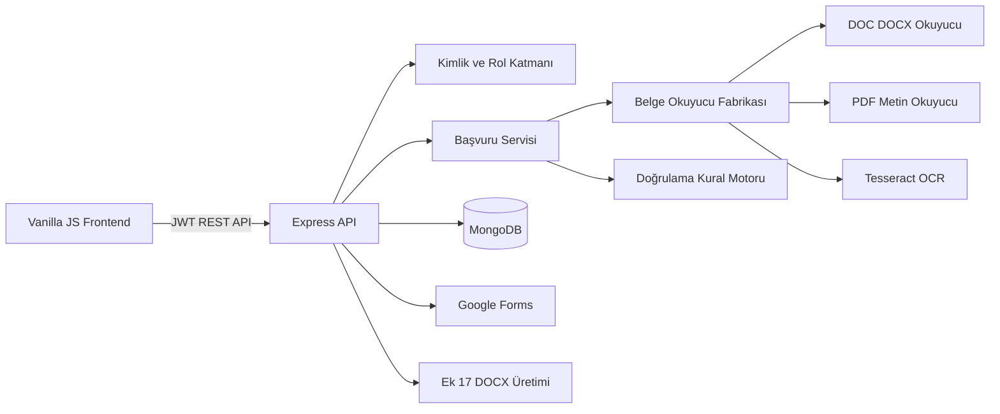
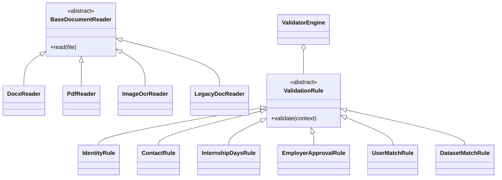
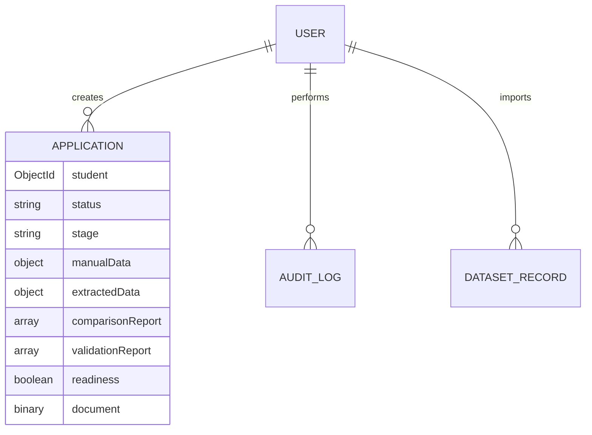

# Sistem Mimarisi

## Bileşenler

## Sınıf diyagramı ve NYP prensipleri

- Kapsülleme: `ValidatorEngine` kural listesini özel `#rules` alanında saklar.
- Soyutlama: `BaseDocumentReader` ve `ValidationRule` doğrudan örneklenemez.
- Kalıtım: Dosya okuyucuları ve doğrulama kuralları temel sınıflardan türetilir.
- Çok biçimlilik: Servis her okuyucunun `read`, motor her kuralın `validate` metodunu aynı sözleşmeyle çağırır.

Final analizinde aynı öğrenci verisi dört kaynakta denetlenir: manuel form, belgeden çıkarılan alanlar, giriş yapan kullanıcı profili ve admin test veri seti.

## Veri modeli

## Güvenlik

Şifreler bcrypt ile hashlenir. JWT rol ve token sürümü taşır; çıkış token sürümünü artırır. Token için zaman aşımı uygulanmaz. Beş başarısız giriş hesabı kilitler. Frontend ve API aynı origin üzerinden sunulur; Helmet, oran sınırlama, dosya boyutu, MIME ve dosya imzası kontrolleri uygulanır. Öğrenci yalnızca kendi başvurusuna erişebilir.
